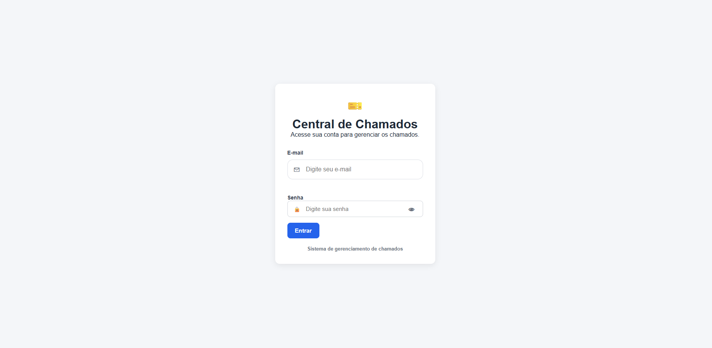
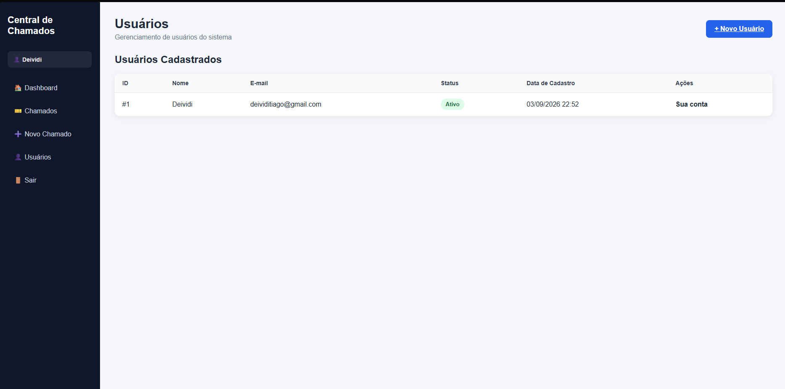
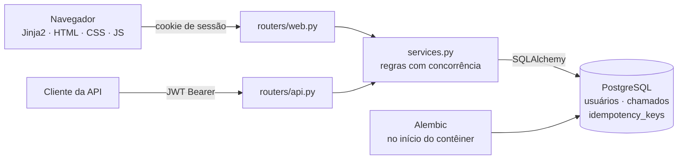

<div align="center">

# Central de Chamados

**Sistema web e API REST para abertura, acompanhamento e fechamento de chamados, com FastAPI e PostgreSQL.**

[](https://github.com/DeividiLuccasdev/central-chamados-fastapi/actions/workflows/ci.yml)


[](https://central-chamados-fastapi.onrender.com/login-web)

[**Sistema online**](https://central-chamados-fastapi.onrender.com/login-web) · [API (Swagger)](https://central-chamados-fastapi.onrender.com/docs) · [GitHub](https://github.com/DeividiLuccasdev)

**Acesso de demonstração**

| E-mail | Senha |
| --- | --- |
| `demo@example.com` | `Demo@2026` |



</div>

> O primeiro acesso pode demorar de 30 a 60 segundos. A aplicação usa o plano gratuito do Render, que "adormece" o servidor após 15 minutos sem uso. Depois que ele acorda, tudo responde normalmente.

## Sobre

A Central de Chamados é um sistema de help desk: usuários autenticados abrem chamados, acompanham o andamento e os resolvem, pela interface web ou pela API REST. As duas portas de entrada usam as mesmas regras de negócio.

O foco está no que costuma quebrar quando várias pessoas usam o sistema ao mesmo tempo: **duas alterações de status simultâneas, cadastros duplicados, envios repetidos do mesmo formulário e mudanças de schema em produção**. Essas garantias são testadas contra um PostgreSQL de verdade no CI.

Projeto de portfólio, criado para praticar e demonstrar Python, FastAPI, APIs REST, PostgreSQL, autenticação, segurança, SQLAlchemy, desenvolvimento web, testes, Git, Docker e deploy em nuvem.

## Funcionalidades

| | |
| --- | --- |
| **Chamados** | Cadastro, listagem, detalhes e alteração de status. Cada chamado tem título, descrição, prioridade, status, usuário responsável e datas de criação, última atualização e fechamento. |
| **Pesquisa e filtros** | Pesquisa por título com autocomplete (sugestões conforme o usuário digita) e filtros por status e prioridade. |
| **Dashboard** | Total de chamados, abertos, em andamento e resolvidos, além dos chamados mais recentes. |
| **Usuários** | Cadastro, ativação e inativação, status da conta e proteção contra inativar a própria conta. Senhas com hash Argon2 e tamanho mínimo validado. |
| **Autenticação** | Login com sessão na interface web e JWT na API. Usuários inativados perdem a sessão e o token. |
| **API REST** | Rotas protegidas por JWT, documentadas com OpenAPI (Swagger), com paginação e abertura idempotente de chamados. → [rotas](docs/api.md) |
| **Concorrência** | Controle otimista no status, e-mail único sem diferenciar maiúsculas e garantia de pelo menos um usuário ativo. → [detalhes](docs/concorrencia.md) |

<table>
  <tr>
    <td width="50%"></td>
    <td width="50%"></td>
  </tr>
  <tr>
    <td align="center"><sub>Dashboard</sub></td>
    <td align="center"><sub>Chamados</sub></td>
  </tr>
  <tr>
    <td width="50%"></td>
    <td width="50%"></td>
  </tr>
  <tr>
    <td align="center"><sub>Usuários</sub></td>
    <td align="center"><sub>Outra tela do sistema</sub></td>
  </tr>
</table>

## Arquitetura



Interface web e API são servidas pela mesma aplicação FastAPI. As regras que precisam ser seguras com requisições simultâneas ficam em `app/services.py` e são chamadas pelos dois routers.

## Decisões técnicas

- **Controle otimista em vez de "o último a gravar vence".** Cada chamado tem uma `versao` e a alteração de status é um `UPDATE` condicional (`WHERE status = ... AND versao = ...`). Se outra pessoa mudou o chamado entre a leitura e a escrita, nenhuma linha é atualizada e a resposta é `409`, em vez de apagar a alteração alheia. Uma tabela de transições impede que um formulário antigo reabra um chamado resolvido.
- **Unicidade garantida pelo banco, não por consulta prévia.** O e-mail é normalizado e protegido por um índice único em `lower(email)`. A consulta antes do `INSERT` só gera a mensagem amigável; quando dois cadastros chegam juntos, o índice decide e o segundo recebe `409`, nunca `500`.
- **Idempotência na abertura de chamados.** Com `Idempotency-Key`, a chave, o hash SHA-256 do conteúdo e a resposta são gravados no mesmo commit do chamado. Repetir a requisição devolve o mesmo chamado; reutilizar a chave com outro conteúdo retorna `422`. O formulário web envia uma chave de uso único e desabilita o botão após o envio, então um duplo clique não cria dois chamados.
- **Trava pessimista onde a regra envolve várias linhas.** "Sempre há um usuário ativo" não cabe num `UPDATE` condicional de uma linha só: a inativação trava os usuários ativos com `SELECT ... FOR UPDATE`, em ordem de id para evitar deadlock.
- **Datas pelo relógio do banco.** Atualização e fechamento usam `now()` do banco, o mesmo relógio de `data_criacao`, para que todas as datas de um chamado venham da mesma fonte.
- **Migrações versionadas e aplicadas no deploy.** O schema é versionado com Alembic e o contêiner roda `scripts.criar_tabelas` antes do uvicorn. Se a migração falhar, a API não sobe e o Render mantém a versão anterior no ar. Bancos criados antes do Alembic são reconhecidos e marcados na revisão inicial.
- **Configuração que falha cedo.** A aplicação não sobe sem `JWT_SECRET_KEY`; o cookie de sessão usa `SameSite=Lax` e passa a `HTTPS only` automaticamente no Render. `.env` fica fora do Git e da imagem Docker, e o contêiner roda sem usuário root.

## Stack

| Camada | Tecnologias |
| --- | --- |
| Backend | Python, FastAPI, SQLAlchemy 2, Pydantic, pydantic-settings, Alembic |
| Autenticação | JWT (PyJWT), sessões (Starlette), Argon2 (pwdlib) |
| Banco de dados | PostgreSQL (Neon em produção), SQLite em memória nos testes rápidos |
| Frontend | Jinja2, HTML5, CSS3 e JavaScript |
| Qualidade | Pytest, Ruff, GitHub Actions (CI) |
| Infra | Docker, Render, Git e GitHub |

## Como rodar

Pré-requisitos: Python 3.11 ou superior e um PostgreSQL acessível.

```bash
pip install -r requirements-dev.txt
cp .env.example .env                 # configure JWT_SECRET_KEY e o banco
python -m scripts.criar_tabelas      # aplica as migrações (Alembic)
python -m scripts.criar_usuario --email voce@exemplo.com --nome "Seu Nome"
uvicorn app.main:app --reload
```

Acesse http://127.0.0.1:8000/login-web. A documentação da API fica em http://127.0.0.1:8000/docs.

O passo a passo completo (ambiente virtual, migração de bancos antigos, verificação de conexão) está em [execução local](docs/execucao-local.md), e as variáveis em [configuração](docs/configuracao.md). Para rodar com Docker:

```bash
docker build -t central-chamados-fastapi .
docker run -p 8000:8000 --env-file .env central-chamados-fastapi
```

## Testes

```bash
pytest
ruff check .
```

A suíte tem 110 testes cobrindo a API, as páginas web, as regras de concorrência, a configuração, os scripts e o login de demonstração. Destes, 99 rodam com SQLite em memória, sem precisar de PostgreSQL. Os outros 11 (`testes/test_postgres.py`, marcador `pg`) disparam requisições simultâneas, cada uma com sua própria conexão, contra um PostgreSQL de verdade, e só rodam com `TEST_DATABASE_URL` apontando para um banco descartável. → [como rodar os testes de PostgreSQL](docs/testes.md)

A cada push na `main` e em todo pull request, o GitHub Actions executa o lint, todos os testes (com um serviço PostgreSQL, então os testes `pg` também rodam) e o build da imagem Docker.

## Estrutura

```text
app/
├── main.py            # Criação da aplicação, middlewares e rotas
├── core/
│   ├── config.py      # Configurações lidas do .env (pydantic-settings)
│   └── security.py    # Hash de senhas (Argon2) e tokens JWT
├── database.py        # Conexão com o banco e sessão do SQLAlchemy
├── models.py          # Modelos Usuario, Chamado e ChaveIdempotencia
├── services.py        # Regras seguras com requisições simultâneas
├── schemas.py         # Validação de entrada e saída da API (Pydantic)
├── dependencies.py    # Autenticação da API (JWT) e das páginas (sessão)
├── templating.py      # Configuração do Jinja2 e filtros
├── routers/
│   ├── api.py         # API REST
│   └── web.py         # Páginas web
├── templates/         # HTML (layout base + páginas)
└── static/            # CSS
docs/                  # Documentação detalhada
migracoes/             # Migrações do banco (Alembic)
scripts/               # Migração das tabelas, usuários (inclusive o de demonstração) e teste de conexão
testes/                # Testes automatizados (pytest)
```

## Documentação

- [API REST](docs/api.md): autenticação, rotas, alteração segura de status e erros
- [Concorrência e idempotência](docs/concorrencia.md): regras e como são testadas
- [Execução local](docs/execucao-local.md) e [variáveis de ambiente](docs/configuracao.md)
- [Docker e deploy](docs/docker-e-deploy.md): imagem, migrações no início do contêiner, Render e Neon
- [Testes](docs/testes.md): suítes, PostgreSQL descartável e CI

## Limitações conhecidas

- Não há perfis de acesso: qualquer usuário logado pode cadastrar, ativar e inativar outros usuários.
- Não há recuperação de senha pelo sistema; a redefinição é feita pelo script `scripts.criar_usuario`, com acesso ao servidor.
- O login não tem limite de tentativas (rate limit).
- Chamados não têm comentários, histórico de alterações nem anexos.
- A demo roda no plano gratuito do Render e hiberna após 15 minutos sem uso.
- Os dados da demo são compartilhados: qualquer visitante pode criar e alterar chamados e cadastrar usuários. Logado na conta `demo@example.com` não é possível ativar nem inativar usuários, ninguém pode inativar a própria demo e ela volta ao estado original (ativa, com a senha publicada) a cada deploy.

## Roadmap

- [ ] Perfis de acesso (administrador e atendente)
- [ ] Histórico de alterações e comentários nos chamados
- [ ] Limite de tentativas de login
- [ ] Recuperação de senha por e-mail

## Autor

**Deividi Luccas** · [GitHub](https://github.com/DeividiLuccasdev)
